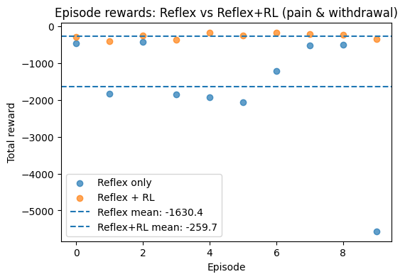
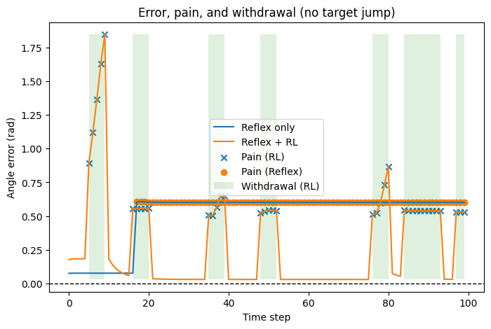
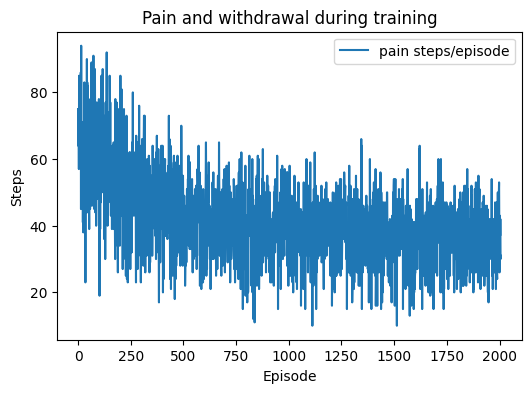
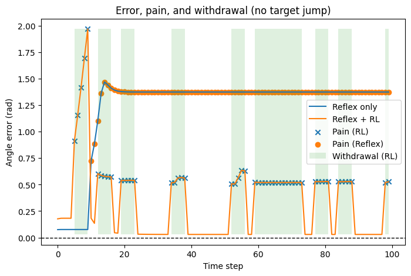

# Reflex + Residual RL for a Musculoskeletal Elbow

A hand-designed **spinal stretch reflex** controls a six-muscle elbow toward a target angle, and a **PPO policy learns a small residual** added to the reflex's muscle commands. A **pain** signal and a **protective withdrawal** response are layered on top: excessive muscle activation or random external stimuli cause pain, and pain moves the arm toward a safe angle.

The environment is MyoSuite's `myoElbowPose1D6MRandom-v0`, simulated in MuJoCo.

<p align="center">
   
</p>

## Controller

```
                 ┌───────────────┐   reflex activations
 q, q_ctrl  ───► │ stretch reflex│ ──────────────┐
                 └───────────────┘               ▼
                 ┌───────────────┐  residual   (+) ──► clip [-1, 1] ──► 6 muscles
 policy state ─► │  PPO policy   │ ────────────► ▲
                 └───────────────┘               │
                                    pain? ── max|activation| > threshold, or random stimulus
                                      │
                                      ▼
                         withdrawal: q_ctrl = q_target + safe_offset
```

**Stretch reflex.** Let `e = q_ctrl − q`. If `|e|` is within the dead zone (0.02 rad), no muscle fires. Otherwise the agonist group fires at `clip(k_p · (|e| − dead_zone), 0, 1)`: the flexors (muscles 0–2) when the joint must flex, the extensors (3–5) when it must extend. The antagonists stay silent.

**Residual policy.** PPO outputs a residual in `[−0.2, 0.2]` for each muscle. Its state is `[q, q̇, q_ctrl, e, pain, in_withdrawal]`.

**Pain and withdrawal.** Pain is raised when any activation exceeds 0.9, or during a random pain event. Events start with probability 0.1 per step and last 5 steps. Pain onset switches the control target to `q_target + 0.5 rad`, and the controller stays in withdrawal while pain persists. Alternatively, `--withdraw-steps N` gives a fixed-length withdrawal.

**Reward.** The environment's own reward is replaced by

```
r = −10·(q_ctrl − q)² − 0.1·q̇² − 0.001·Σ act² − 2·pain
```

## Results

These numbers are from the original notebook run: one training seed, 2×10⁵ PPO steps, and 10 evaluation episodes.

| Controller | Mean episode reward |
|---|---|
| Reflex only | −1630.4 |
| Reflex + learned residual | **−259.7** |

During training, pain steps per 100-step episode fell from roughly 60–70 to roughly 35–40 (mean 41.6 over 2,007 episodes).

<p align="center">
   
</p>

**What the policy learns.** Reflex-only control can get trapped in a pain loop. Withdrawal moves the control target 0.5 rad away, which saturates the reflex at full activation (1.0). That exceeds the 0.9 pain threshold, so pain continues and withdrawal never ends. If the safe target lies beyond the joint's range, the arm stays stuck (the flat segments in the traces above). The learned residual subtracts about 0.2 from the agonists during withdrawal. This holds activation at 0.8, below the threshold, which breaks the loop. Most of the reward gap comes from this learned *pain avoidance*. The unit tests reproduce the mechanism (`test_saturated_reflex_keeps_itself_in_withdrawal`, `test_negative_residual_breaks_the_pain_loop`).

## Repository layout

```
reflexrl/                Python package
  observations.py        raw observation parsing and policy state
  reflex.py              dead-zone stretch reflex
  reward.py              shaped reward
  wrapper.py             ReflexResidualElbow (reflex + residual + pain + withdrawal)
  env.py                 environment construction and default settings
  callbacks.py           SB3 callback logging pain/withdrawal per episode
  evaluation.py          rollouts, paired reflex vs. RL comparison
  plotting.py, video.py  figures and episode videos
  config.py              shared command-line options, run configs
scripts/                 command-line entry points (each has --help)
tests/                   unit tests on a lightweight stand-in elbow (no MuJoCo needed)
figures/                 figures from the original experiments
```

## Setup

Requires Python 3.10+.

```bash
git clone https://github.com/<your-username>/reflex-residual-rl.git
cd reflex-residual-rl
python -m venv .venv && source .venv/bin/activate
pip install -r requirements.txt
pip install -e .
pytest            # unit tests
```

## Usage

```bash
# Inspect the environment and step the wrapper with a constant residual
python scripts/inspect_env.py --steps 10

# Bare reflex on the raw environment
python scripts/reflex_only.py

# Train (saves runs/<name>/model.zip, config.json, episodes.csv)
python scripts/train.py --name reflex_rl --timesteps 200000

# Pain and reward over training
python scripts/plot_training.py --run runs/reflex_rl

# Reflex only vs. reflex + RL, on matched seeds (same targets and pain events)
python scripts/evaluate.py --model runs/reflex_rl --episodes 10

# Episode video: 2D schematic, or the MuJoCo scene
python scripts/make_video.py --model runs/reflex_rl
MUJOCO_GL=egl python scripts/make_video.py --model runs/reflex_rl --mujoco
```

Every wrapper setting can be changed from the command line: `--residual-scale`, `--dead-zone`, `--reflex-gain`, `--pain-threshold`, `--withdraw-steps`, `--safe-offset`, `--lambda-pain`, `--random-pain-prob` and `--random-pain-steps`. `evaluate.py` and `make_video.py` reuse the settings saved with the run unless you override them. Example ablations:

```bash
python scripts/train.py --name no_random_pain --random-pain-prob 0
python scripts/train.py --name timed_withdrawal --withdraw-steps 20
python scripts/train.py --name larger_residual --residual-scale 0.5
```

For headless MuJoCo rendering, use `MUJOCO_GL=egl` on a machine with a GPU or `MUJOCO_GL=osmesa` on a CPU-only one. The schematic video needs no OpenGL.

## Acknowledgments

Built on [MyoSuite](https://github.com/MyoHub/myosuite), [MuJoCo](https://mujoco.org) and [Stable-Baselines3](https://github.com/DLR-RM/stable-baselines3).

```bibtex
@inproceedings{caggiano2022myosuite,
  title     = {MyoSuite: A Contact-rich Simulation Suite for Musculoskeletal Motor Control},
  author    = {Caggiano, Vittorio and Wang, Huawei and Durandau, Guillaume and Sartori, Massimo and Kumar, Vikash},
  booktitle = {Learning for Dynamics and Control Conference (L4DC)},
  year      = {2022}
}

@article{raffin2021sb3,
  title   = {Stable-Baselines3: Reliable Reinforcement Learning Implementations},
  author  = {Raffin, Antonin and Hill, Ashley and Gleave, Adam and Kanervisto, Anssi and Ernestus, Maximilian and Dormann, Noah},
  journal = {Journal of Machine Learning Research},
  volume  = {22},
  number  = {268},
  pages   = {1--8},
  year    = {2021}
}
```

## License

MIT; see [LICENSE](LICENSE).
